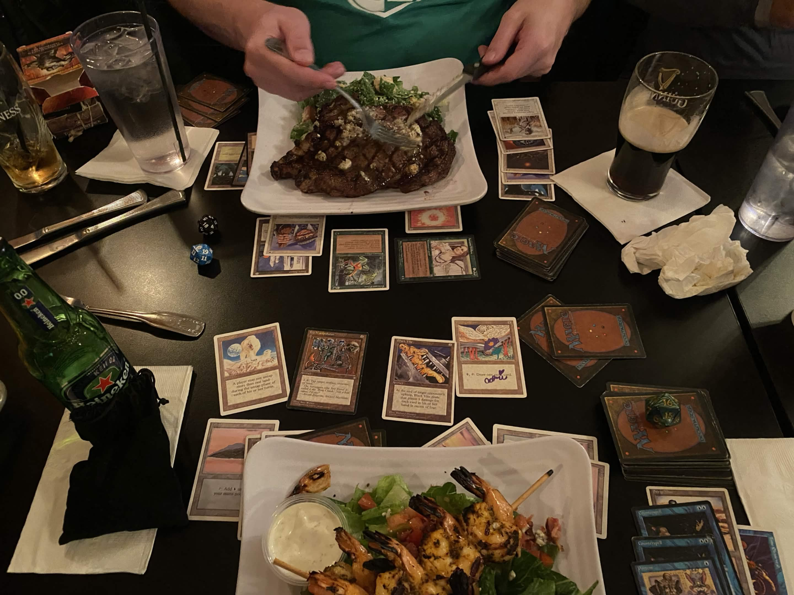

## Why Classic FEB?

I've been struggling lately with hFEB in my local meta. This is partly because folks are becoming more and more savvy to interacting with it, but also because there seems to have been a real up-tick in both Terrageddon and Ponza Oath. These are tougher matchups for hFEB's non-basic mana base. Eladamri's Vineyard is good tech but the way that it also accelerates them has never sat well with me. These are the observations that led me to [this list](https://moxfield.com/decks/-0XfkUifBU2jrqP6ZPGOnw).

## The Build

I wanted to play more basics than other classic FEB lists I've seen, and just have more lands in general. The deck needs 5 mana to execute its most difficult-to-stop line, so it seems natural to me to play more lands than the Hermit version.

Trying to fit all 5 basics into the deck seems like too much. We need to make a lot of green and I'm already complicating things with 4 lands that don't do that. So I decided to cut all the red cards from the sideboard. Instead of Ghitu Slinger and Pyroclasm I have Bone Shredder (in the main), Plague Spitter and Engineered Plague.

Since I have basic lands to cover my four colors, I've been testing out Yavimaya Elder instead of ESG. I've never been comfortable with ESG as a one-shot spot of mana. How about instead we flashback Cabal Therapy and bank two land drops?

I've already written [a bit](https://hfeb.guide/blog/a-horrible-build/) about Krovikan Horror. It is included here because the classic builds want to go a bit longer, and Horror complements that plan by affording you twice as many survival activations, given enough mana.

One thing I like about hFEB is how you can very reasonably drop back to a simple beatdown plan using Karmic Guide and Akroma. cFEB doesn't really have that option, hence my inclusion of Phyrexian Dreadnought. We're not running Stifle or anything, we're just looking to surprise people with a 12/12 Shapeshifter, since we can skip the part where it enters the battlefield. I like Dreadnought over the other options because of a few niche interactions. One, I can Enlightened Tutor for it. Two, I can get it into the graveyard just by casting it and letting it die. Three, this approach does not care about Cursed Totem.

The last note on my card choices before I get into the games is regarding Enlightened Tutor. I like that it has a lot of utility outside of "just" getting Survival. It helps find the FEB combo, and I have some high impact artifacts and enchantments out of my sideboard. Honestly though, all these reasons are secondary to the fact that Intuitions are pricey and I just don't want to own four!

## The Swiss Rounds

### Round 1 vs Ray playing Mono Black (LWW)

Ray opens our match with two Withered Wretches vs my two birds. I have Mesmeric Fiend to grab his Plague Spitter. He draws into Powder Keg which he opts to blow on 1 and take my birds. This puts me too far behind on mana, which is compounded by my inability to generate card advantage with Squee or Krovikan Horror with Withered Wretch in play.

I board out Bone Shredder and 4x Cabal Therapy, bringing in 3x Swords to Plowshares, Uktabi Orangutan and Monk Realist.

Game 2 I open on Birds, into Enlightened Tutor in my second upkeep to get and play Survival. He taps out on his turn 3 to play Hypnotic Specter which is enough of an opening to win with Unearth and Palinchron.

Game 3 he doesn't have the turn 1 Duress so I resolve Survival. Then, he drops Withered Wretch but this time I have Swords. I wasn't holding any creatures though, so when I drew Enlightened Tutor I realized that I could get and pitch Phyrexian Dreadnought to kick start my engine. I didn't want to expose Dev or Trike to another Wretch so I was actually pretty pleased that the shrimp could help me out here.

### Round 2 vs Brian playing GW Ponza Oath (WLW)

I've crossed paths with Brian many times, so I'm pretty sure he's on GW Oath. I miscounted my mana to lose our last match, and he respectfully notes that he can't expect me to mess up my lines again... Sure you can, Brian!

I open with Cabal Therapy (Naturalize?) and whiff, seeing Swords, Terravore, Wastelands and Factories. Thanks to my basic lands I can actually rub two mana together, cast Survival, and win fairly quickly after that.

I board out 4x Birds for Tsabo's Web, Uktabi Orangutan, Monk Realist, and Naturalize.

For game two Brian audibly wishes for a turn 1 Sylvan Library hand and gets it. Oof. He happily pays 4 and then 8 while I am trying to resolve Survival and not trigger his Oath. From there he gives me the option to tap out to resolve Shapeshifter and I take it, reasoning that things are only going to get worse for me the longer this goes on. I can't afford to wait on the off-chance that he has Swords. Instead what happens is a super deep Oath trigger that uncovers Ray of Revelation. It obviously blows up my Survival and I'm dead.

I win game 3 using dumb luck. I keep a 4-land hand but no Survival/Intuition. My first draw step? Survival! His turn? Naturalize! Easy come, easy go I guess. Second draw step? Survival again! I play Wall of Roots and Survival. He can't destroy it, but he does have Cursed Totem. I respond with my last Wall activation for a while to get Squee. It takes a couple more turns for me to get into a position where I can Uktabi the Cursed Totem and go off.

### Round 3 vs Sam playing BW Control (WW)

Sam plays a swamp and Duresses me, taking my Survival. I have 2 Cabal Therapies, and then draw a third one. I forget the exact sequence, but I whiff when I name Withered Wretch. On the following turn I let him keep his 2x Gerrard's Verdicts because I have Squee, and deprive him of his Exalted Angels. My next draws are great: Unearth and Auramancer. I craft a plan that involves him hitting me with Verdict again so I can Unearth Auramancer and play the rebought Survival right away, and it works. It's a short hop from here to the win.

I board out 3x Cabal Therapy and bring in Monk Realist, Uktabi Orangutan, and Naturalize.

Game 2 he opens on Tormod's Crypt and Barren Moor. I cast Birds. He casts Gerrard's Verdict and I discard Squee + Land. He activates the Crypt to take Squee. I cast Intuition in his end step for 3x Survivals, untap and play it. I forget the exact line, but I go for Palinchron, and he responds with Skeletal Scrying for 2 with one white open but doesn't hit the Swords. GGs!

### Round 4 vs Frank playing Reanimator (WW)

Did I mention that this was also a costume party? Frank was dressed as a perfectly rendered Towelie. I have a Birds plus Survival opening, which plays super well into his turn 2 Exhume. I'm able to pitch Shapeshifter to Survival in response to the Exhume and then untap and win right away.

I board out 3x Cabal Therapy and bring in 3x Swords to Plowshares.

Game 2 Frank has to mull to four, but finds a turn two Akroma. I have Survival in play, but my only creatures in hand are Dev and Trike. I tank for a minute in his end step over my one untapped green mana and hand of creatures I don't want to pitch. I decide not to activate and just draw for the turn... and I hit Palinchron.

### R5 vs Justin Mwah! (ID)

I'm happy to ID vs Justin, who has returned to playing Goblins after a bit of a break. We share some yucks, and then I get to play some AAA while the rest of the room is hitting their rubber matches.

### R6 vs Neal Sacks (ID)

Neal is also interested in drawing. We chat about the cool content [Squee's House of Pizza](https://squeeshouseofpizza.com/en-usd) has been coming up with and he gives me some swag. After a quick gander at the top tables I decide to just watch the AAA instead of play since I don't want to burn myself out.

Neal also wrote up a tournament report and you can read it [here](https://thesack1.substack.com/p/shoe-city-showdown-5-tournament-report7th)!

## Quarterfinals

### vs Matt Dietz playing Sligh

Matt is another friendly local who I've had a few games with, we both know what each other is up to and we just get into it. I'm the 3rd seed so I'm on the play.

My game 1 hand is the nuts. Something like Wall, Survival, Palinchron, Devourer, and three lands. Meanwhile, he gets stuck on one land. I'm able to go off with a Palinchron trigger plus 2 green mana to spare in case he has a bunch of free burn but it's not necessary. I'm going to wish that this luck was spread out across multiple games instead of concentrated in this one.

I board out 4x Cabal Therapy and bring in 3x Xantid Swarm and Uktabi Orangutan. This is just to up the creature count, I'm definitely not planning on casting the bees.

I'm finally running out of memories of this event. I lose game 2 in a way that felt pretty normal to me. I think he had Tormod's Crypt to snag my Squee. That's enough of a stumbling block to make me lose the race.

Game 3 I have to make do with an Intuition hand. I have a lot of mana dorks, and I let that surplus carry me into a bit of a punt. My first bird takes 2 points of burn. I make the fateful Wall of Roots plus Birds play. Matt lays out a pile of 1-drops. I untap, draw a land, play a land, and with 5 total mana cast Intuition and the Survival it fetched me. Note that at this point, I have no creatures in hand. I do some blocking and draw another land. I take even more damage, draw another land, and that's the end of my tournament!

## Lessons Learned

It's a bummer to punt in the Top 8, but I choose to see that as an opportunity to grow. I'd rather punt a game and receive a lesson than be able to complain about bad beats. Keeping a creature in hand for pitching to Survival isn't a new idea to me, but keeping a cool head after 7 hours of Magic, slowing down, and thinking things through even though you're pumped up about being in the quarterfinals... that is something I need to work on.

I think I made the right meta call, given that there were 6 Terravore decks, 4 BW Control, 4 Landstill, and a host of other slower, controlly decks in the room. You can see the full breakdown [here](https://www.zoocrew.team/decklists/scs5/): BTW I think Zoo Crew's site is slick and the presentation is great. It just needs card info on hover!

I also got lucky in the Swiss rounds. Never mulled to oblivion, dodged fast combo and aggro (until the end), which I think this build is softer to, and I topdecked Palinchron in all the right spots.

I had no problems with Krovikan Horror. I didn't always need it, but it's nice being able to shift into a 5th gear. Your board takes a little longer to develop since you're committing lots of mana to Survival activations, but your card velocity is great. Mesmeric Fiend is another card that I've been running for a while, even in hFEB. It didn't quite make it into the blow by blow above but I went for Fiend often enough to say it's a core piece.

Yavimaya Elder didn't come up much, so I'm still going to consider it in-testing. There was one spot where I could have fetched it vs Oath but it ended up being better to just get Palinchron and go for the win since I was sure that he didn't have Swords. Ideally it comes out on turn three with a Cabal Therapy already in the yard... but maybe that's too narrow a situation? Definitely going to keep an eye on the old man.

Phyrexian Dreadnought played an unexpected role against mono black as a creature that I didn't mind pitching to Survival, and could find with Enlightened Tutor. It's not a play I would aim for, but it certainly did the job in a pinch. I'm sure there are more interesting artifact creatures I could be running if all I need is a way to convert Enlightened Tutor into a creature. I do want an alternate way to win, so I'll give it more time, but this guy is also on notice.

## Wrap Up

Overall, Zoo Crew ran another great event at [Webway Games](https://www.webwaygames.com/) in Marlborough MA, and I'm looking forward to the next one. And if you're in the area, you can get some great food at Double T's Tavern down the road:

*Aside from being deeply obsessed with Premodern, Will has wasted 20 years of his life making video games. You can find his latest work at [Go On Entertainment](https://go-on-entertainment.com). He is whhthe2 on Discord.*
